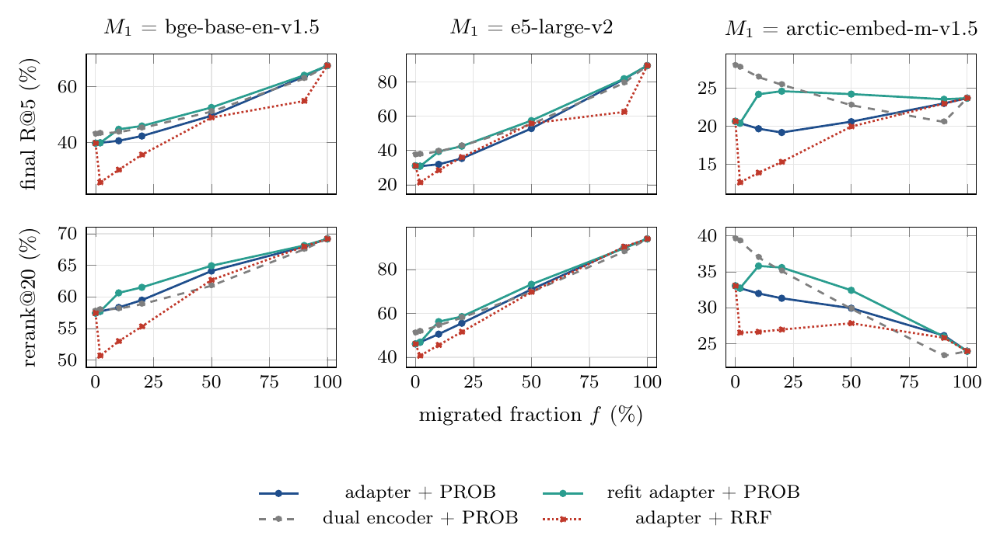
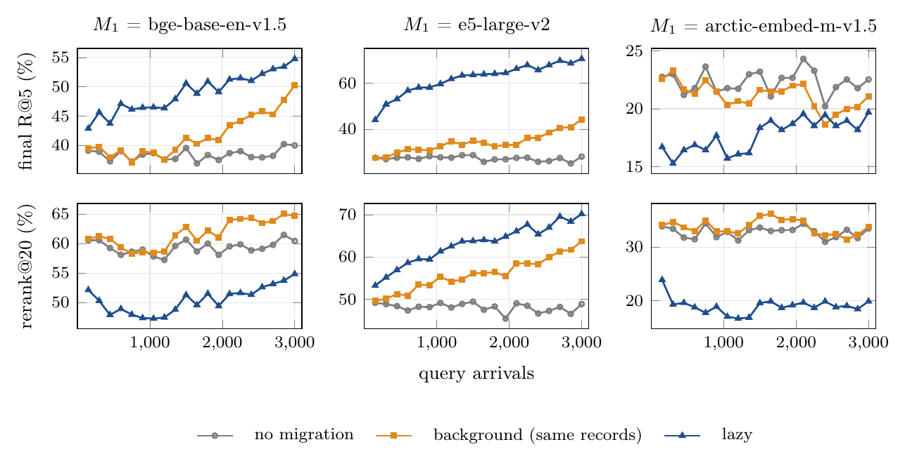
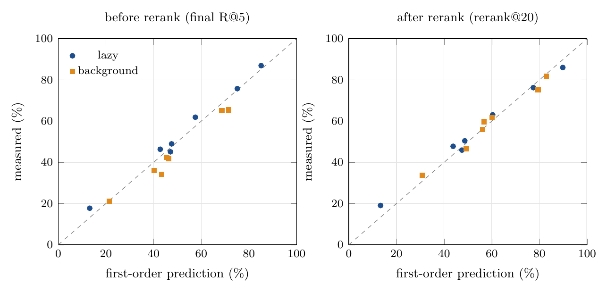

# E9. Supporting components: query adapter, fusion rule and network accounting (rounds 4 to 6)

The split-map query adapter lets clients that run only M₁ reach legacy records, and the fusion rule PROB merges the candidate lists of the two epochs. Round 4 evaluated both against the prespecified criteria S1 to S4 with the original SRP placement. Rounds 5 and 6 are exploratory: adapters fitted on PQ reconstructions, recall computed from simulated iterative lookups, network and computation costs, and a replay of the migration schedule.

| | |
|---|---|
| In the paper | Methods, "Supporting components: legacy adapter and cross-epoch fusion" |
| Rounds and hypotheses | 4 (S1 to S4, 15 of 20 criteria met), 5 and 6 (exploratory) |
| Analysis scripts | the commands in the section "Supporting components (rounds 4 to 6)" of the repository README |

## Method details

### Fusion rule PROB

When the two epochs hold disjoint objects, reciprocal rank fusion gives the same score to the same rank in both lists and interleaves them regardless of how many objects each epoch holds. PROB instead models the exact M₁ similarity y_o of each candidate. For a legacy candidate with adapter score x_o it assumes y_o∣ x_o~N(a₁x_o+a₀,σ₀²), with a₀, a₁ and σ₀ fitted by least squares with five-fold cross-fitting on calibration queries, and for a candidate with native ADC score ŷ_o it assumes y_o∣ŷ_o~N(ŷ_o,σ₁²). The k-th largest similarity is modeled as a threshold τ~N(τ̄,s_τ²), estimated from 128 fixed draws, and a candidate with predicted mean μ_o and deviation σ_o (a₁x_o+a₀ and σ₀ for a legacy candidate, ŷ_o and σ₁ for a native one) receives

$$
\rho_o=\Phi\!\left(\frac{\mu_o-\bar{\tau}}{\sqrt{\sigma_o^2+s_\tau^2}}\right).
$$

The two lists are merged by comparing the ρ_o of their current heads, which keeps the order within each list.

### Supporting components and the deviations of round 4

The adapter and the fusion rule were evaluated with prespecified criteria in a round of their own (round 4, seeds 3 to 5) with the original SRP placement, on code 100k with fresh queries for three target models and on the two smaller corpora for Arctic ([Table E9.14](#table-e914)). Two transitions met all four criteria on code 100k. Arctic met only S3 there and failed S2 on all three corpora. We deviated from the written plan in two ways: the ridge coefficient was chosen on a 20% holdout instead of by five-fold cross-validation, and the repository tag was moved once, before the first confirmatory job, to revise the prompt of an exploratory paraphrase workload.

With 5,000 training pairs on code 100k, the split-map adapter came within 0.4 points (bge-base) and 2.4 points (e5-large) of a client that keeps both models, measured by the worst reranked gap, but it was 7.5 points behind for Arctic. With the 2,000 pairs of the sample S that the migration experiments use, the gaps were 3.1, 6.3 and 7.8 points ([Table E9.1](#table-e91)). Keeping only M₁ needed 418 MiB of client memory against 1,694 MiB for both models. Per-record normalization added 1.9 to 29.3 points of final recall over the same maps without it, and the split maps beat a single ridge map by 5.4 to 10.5 points. With 10% of the corpus migrated, PROB was 3.5 to 12.1 points above reciprocal rank fusion in all five configurations; rank fusion gave about half of the top five to an epoch that held 2% of the corpus. PROB did not beat calibrated-score baselines before reranking. Refitting the adapter on migrated pairs added 3.0 to 8.6 points at 50% migrated, and fitting every map on PQ reconstructions instead of full M₀ embeddings left all 20 outcomes unchanged. Arctic failed S2 because, under SRP, its complete native index found fewer true neighbors after reranking than its legacy path did (24.0% against 33.0% on code 100k), so recall fell as records moved over. Recall computed with simulated iterative lookups instead of ideal probes was 0.3 to 4.7 points lower before reranking and 1.2 to 5.3 points lower after it.

## Results

The tables and figures below come from the prespecified evaluation of the adapter and the fusion rule (round 4) and from exploratory rounds 5 and 6, all with the original SRP placement of the native epoch.

The adapter and the fusion rule were evaluated with prespecified criteria in a round of their own (round 4, seeds 3 to 5) with the original SRP placement; [Table E9.14](#table-e914) and the Methods of the paper report the outcomes, the deviations from the written plan and the remaining measurements, and [Table E9.1](#table-e91) to [Table E9.13](#table-e913) and [Figure E9.1](#figure-e91) to [Figure E9.3](#figure-e93) give the analyses in full. Two of the three transitions on code 100k met all four criteria. With the 2,000 pairs of the sample S that the migration experiments use, the split-map adapter stayed 3.1, 6.3 and 7.8 points behind a client that keeps both models, and with 10% of the corpus migrated PROB was 3.5 to 12.1 points above reciprocal rank fusion in all five configurations, although it did not beat calibrated-score baselines before reranking. Arctic failed the fusion criterion on all three corpora because, under SRP, its complete native index found fewer true neighbors after reranking than its legacy path did (24.0% against 33.0% on code 100k), so recall fell as records moved over. C1 explains this weakness, and learned placement raised the native recall of Arctic by 16.5 to 17.8 points at equal candidates (see [E2](E2_learned_placement.md)).

## Tables and figures

### Table E9.1

Worst holdout recall gap versus dual encoding across rerank depths R = 5 to 100 (points); last column: dual final R@5.

| Corpus, M₁ | n = 1,000 | n = 2,000 | n = 5,000 | Dual final R@5 |
|---|---|---|---|---|
| 100k, bge-base | −7.0 | −3.1 | +0.4 | 42.2 |
| 100k, e5-large | −9.5 | −6.3 | −2.4 | 36.8 |
| 100k, arctic | −11.9 | −7.8 | −7.5 | 27.4 |
| 20k, arctic | −11.5 | −7.6 | −3.8 | 37.0 |
| SciFact, arctic | −4.6 (n = 518) | +5.7 |  | 42.0 |

### Table E9.2

Cross-epoch outcomes. Min. step: most negative change in rerank@20 between adjacent grid fractions (positive if rerank@20 never decreases). AD: adapter fitted on S; ADR: refitted adapter.

| Corpus, M₁ | `PROB` − `RRF` f = 10% | Min. step | rerank@20 f = 0 → 1 | `ADR` − AD f = 50% |
|---|---|---|---|---|
| 100k, bge-base | +10.4 | +0.3 | 57.4 → 69.2 | +3.0 |
| 100k, e5-large | +3.5 | +0.8 | 46.1 → 93.9 | +4.6 |
| 100k, arctic | +5.8 | −3.8 | 33.0 → 24.0 | +3.6 |
| 20k, arctic | +8.9 | −1.6 | 50.5 → 48.3 | +3.2 |
| SciFact, arctic | +12.1 | −4.7 | 66.2 → 48.6 | +8.6 |

### Table E9.3

Fusion baselines: final R@5 / rerank@20 (three-seed means). Only PROB versus RRF at f = 10% is confirmatory.

| Corpus, M₁ | `PROB` | `RRF` | `CAL` | `SD` | `PROP` |
|---|---|---|---|---|---|
| ***f = 10%*** |  |  |  |  |  |
| 100k, bge-base | 40.7 / 58.3 | 30.3 / 53.0 | 38.7 / 57.2 | 41.3 / 57.9 | 36.6 / 58.1 |
| 100k, e5-large | 31.9 / 50.5 | 28.4 / 45.5 | 26.3 / 45.8 | 30.8 / 47.6 | 28.7 / 50.8 |
| 100k, arctic | 19.7 / 32.0 | 13.9 / 26.6 | 16.7 / 30.3 | 16.8 / 30.0 | 19.2 / 31.5 |
| 20k, arctic | 32.3 / 49.7 | 23.4 / 43.0 | 28.6 / 47.6 | 28.2 / 46.9 | 29.3 / 49.0 |
| SciFact, arctic | 39.2 / 62.7 | 27.1 / 54.2 | 40.1 / 62.5 | 38.0 / 59.2 | 37.4 / 62.2 |
| ***f = 50%*** |  |  |  |  |  |
| 100k, bge-base | 49.6 / 64.1 | 49.0 / 62.7 | 45.6 / 60.1 | 50.8 / 61.9 | 49.0 / 62.7 |
| 100k, e5-large | 52.8 / 70.9 | 55.8 / 69.7 | 49.5 / 59.4 | 53.4 / 63.4 | 55.8 / 69.7 |
| 100k, arctic | 20.6 / 29.9 | 20.0 / 27.8 | 16.3 / 25.2 | 16.4 / 24.7 | 20.0 / 27.8 |
| 20k, arctic | 37.7 / 51.1 | 37.0 / 48.2 | 31.8 / 45.3 | 31.7 / 44.8 | 37.0 / 48.2 |
| SciFact, arctic | 41.3 / 59.5 | 40.4 / 55.7 | 43.1 / 57.9 | 40.4 / 53.1 | 40.4 / 55.7 |

### Table E9.4

Zipf(1) stream (3,000 arrivals; three seeds): final R@5 / rerank@20 / payloads per query. Last column: lazy minus matched background.

| Corpus, M₁ | Static | Lazy | Background | Lazy − background |
|---|---|---|---|---|
| 100k, bge-base | 38.4 / 59.4 / 19.7 | 49.0 / 50.4 / 12.9 | 41.7 / 61.7 / 17.6 | +7.3 / −11.2 |
| 100k, e5-large | 27.4 / 48.1 / 18.6 | 61.9 / 63.1 / 11.9 | 34.2 / 55.9 / 15.6 | +27.6 / +7.1 |
| 100k, arctic | 22.3 / 32.8 / 19.6 | 17.7 / 19.1 / 14.7 | 21.1 / 33.8 / 17.4 | −3.4 / −14.7 |
| 20k, arctic | 26.0 / 42.9 / 18.4 | 46.3 / 47.8 / 6.0 | 36.0 / 46.5 / 15.9 | +10.3 / +1.3 |
| SciFact, arctic | 40.2 / 65.9 / 18.5 | 45.1 / 45.9 / 1.6 | 42.4 / 59.7 / 15.9 | +2.7 / −13.7 |

### Table E9.5

Native index versus legacy adapter. Rerank@20 uses exact reranking of 20 candidates; candidates per query: active objects held by the contacted peers.

| Corpus, M₁ | Native index final / rerank@20 | Candidates per query | Legacy path, f = 0 final / rerank@20 |
|---|---|---|---|
| 20k, bge-base (dev.) | 81.6 / 84.1 | 10,072 | 53.4 / 73.9 |
| 20k, e5-large (dev.) | 92.8 / 97.9 | 18,171 | 44.4 / 63.8 |
| 100k, bge-base | 67.6 / 69.2 | 24,132 | 39.8 / 57.4 |
| 100k, e5-large | 89.5 / 93.9 | 77,403 | 31.0 / 46.1 |
| 100k, arctic | 23.7 / 24.0 | 10,824 | 20.7 / 33.0 |
| 20k, arctic | 47.2 / 48.3 | 6,647 | 32.3 / 50.5 |
| SciFact, arctic | 48.2 / 48.6 | 1,455 | 42.6 / 66.2 |

### Table E9.6

Paraphrase workload (exploratory, development seeds). First: first arrival of an intent; exact repeat: previously seen wording (77% of arrivals); new wording: seen intent, unseen wording.

| Corpus, M₁ | Final static / lazy / bg | Lazy first / exact repeat / new wording | Static new wording |
|---|---|---|---|
| 20k, bge-base | 51.0 / 79.7 / 64.4 | 60.4 / 82.2 / 75.4 | 49.8 |
| 20k, e5-large | 38.3 / 87.2 / 62.9 | 51.2 / 91.4 / 81.2 | 33.8 |
| SciFact, bge-base | 53.0 / 81.5 / 65.9 | 72.6 / 82.4 / 81.0 | 51.9 |
| SciFact, e5-large | 41.7 / 83.9 / 59.3 | 70.2 / 85.1 / 83.9 | 40.8 |

### Table E9.7

Exploratory re-indexer sensitivity (development seeds): lazy minus matched-record background, final R@5 (points). Cap: records per arrival; delay: arrivals before publish.

| Corpus, M₁, workload | unbounded | cap 3 | cap 1 | delay 150 | delay 600 |
|---|---|---|---|---|---|
| 20k, bge-base, verbatim | +10.6 | +7.6 | +3.7 | +8.1 | +6.1 |
| 20k, bge-base, paraphrase | +15.3 | +15.1 | +12.4 | +12.3 | +12.0 |
| 20k, e5-large, verbatim | +21.5 | +22.7 | +18.0 | +19.4 | +18.5 |
| 20k, e5-large, paraphrase | +24.2 | +25.0 | +21.0 | +20.1 | +20.3 |
| SciFact, bge-base, verbatim | +18.1 | +14.8 | +13.0 | +15.3 | +9.9 |
| SciFact, bge-base, paraphrase | +15.6 | +12.8 | +11.8 | +13.4 | +8.1 |
| SciFact, e5-large, verbatim | +26.9 | +21.2 | +17.5 | +22.0 | +13.1 |
| SciFact, e5-large, paraphrase | +24.6 | +20.0 | +18.5 | +21.0 | +12.8 |

### Table E9.8

Per-query simulated cost at fixed migration states (CodeSearchNet 20k, M₁ = bge-base; 10k peers; three development seeds; `PROB`; rerank 20 payloads).

| State | Final / R20 | RPCs: total (find / ADC / payload) | KB | CPU (s) | p50 (s) | p50 (s) no rerank |
|---|---|---|---|---|---|---|
| dual, f = 0 | 51.2 / 71.2 | 13,052 (826 / 497 / 11,728) | 2,150 | 7.80 | 11.56 | 0.80 |
| adapter, f = 0 | 53.4 / 73.9 | 12,994 (829 / 488 / 11,677) | 2,147 | 7.67 | 11.43 | 0.68 |
| adapter + E₁, f = 10% | 54.3 / 74.4 | 13,772 (1,658 / 972 / 11,143) | 2,460 | 7.29 | 11.13 | 0.71 |
| adapter + E₁, f = 50% | 64.0 / 80.0 | 11,906 (1,665 / 975 / 9,265) | 2,233 | 6.07 | 9.84 | 0.71 |
| adapter + E₁, f = 90% | 77.6 / 83.3 | 10,220 (1,659 / 973 / 7,588) | 1,967 | 4.92 | 8.77 | 0.71 |
| native, f = 100% | 81.6 / 84.1 | 1,332 (845 / 487 / 0) | 508 | 0.04 | 0.68 | 0.68 |

### Table E9.9

Amortized cost per query under Zipf(1), bge-base (rerank 20 payloads). 20k/SciFact: 10k peers; 100k: 50k peers.

| Corpus, policy | Client RPC | KB | Payloads | CPU (s) | p50 / p95 (s) | Re-indexer RPC / CPU (s) |
|---|---|---|---|---|---|---|
| 20k, static | 13,581 | 2,439 | 18.7 | 7.17 | 11.00 / 11.59 | 0 / 0 |
| 20k, background | 11,680 | 2,186 | 15.5 | 5.90 | 9.68 / 11.14 | 4,266 / 2.29 |
| 20k, lazy | 5,857 | 1,302 | 6.0 | 2.31 | 2.17 / 9.82 | 4,266 / 2.29 |
| 20k, lazy, cap 3 | 10,959 | 2,087 | 14.3 | 5.44 | 9.11 / 10.87 | 2,133 / 1.14 |
| SciFact, static | 13,260 | 2,337 | 18.3 | 7.00 | 10.72 / 11.57 | 0 / 0 |
| SciFact, lazy | 2,725 | 696 | 1.6 | 0.66 | 0.70 / 9.21 | 1,382 / 0.59 |
| 100k, static | 18,777 | 3,236 | 19.7 | 7.56 | 11.92 / 12.36 | 0 / 0 |
| 100k, background | 17,356 | 3,080 | 18.0 | 6.88 | 11.28 / 12.10 | 13,878 / 5.00 |
| 100k, lazy | 13,793 | 2,597 | 13.4 | 5.12 | 9.47 / 11.27 | 13,879 / 5.00 |

### Table E9.10

Fixed-state probe versus integrated lookup recall at all evaluated states (three-seed means; 20k: 10k peers, development seeds; 100k: 50k peers, seeds 3 to 5). AD: adapter; DU: dual encoder; for f > 0 each is fused with E₁ by `PROB`; native: full E₁. Reductions quoted in the paper are computed from unrounded means.

| State | 20k, bge-base | 100k, bge-base | 100k, e5-large | 100k, arctic |
|---|---|---|---|---|
| ***Final R@5*** |  |  |  |  |
| DU, f = 0 | 51.2 → 50.2 | 43.0 → 40.7 | 37.4 → 35.2 | 28.0 → 26.2 |
| DU, f = 10% | 52.6 → 51.4 | 43.8 → 41.6 | 39.5 → 37.8 | 26.5 → 25.2 |
| DU, f = 50% | 61.7 → 60.7 | 51.1 → 47.8 | 55.3 → 53.4 | 22.8 → 21.1 |
| DU, f = 90% | 76.5 → 75.0 | 63.0 → 58.3 | 79.3 → 76.3 | 20.6 → 19.4 |
| AD, f = 0 | 53.4 → 52.5 | 39.8 → 37.4 | 31.0 → 29.6 | 20.7 → 19.4 |
| AD, f = 10% | 54.3 → 53.4 | 40.7 → 38.9 | 31.9 → 30.7 | 19.7 → 19.4 |
| AD, f = 50% | 64.0 → 63.5 | 49.6 → 46.7 | 52.8 → 50.4 | 20.6 → 19.3 |
| AD, f = 90% | 77.6 → 75.8 | 63.7 → 59.4 | 81.6 → 77.9 | 23.0 → 22.1 |
| native, f = 100% | 81.6 → 79.9 | 67.6 → 63.2 | 89.5 → 86.4 | 23.7 → 21.7 |
| ***Rerank@20*** |  |  |  |  |
| DU, f = 0 | 71.2 → 68.9 | 57.7 → 53.9 | 51.0 → 47.7 | 39.6 → 37.0 |
| DU, f = 10% | 72.3 → 70.1 | 58.1 → 54.7 | 54.5 → 51.6 | 37.0 → 35.1 |
| DU, f = 50% | 77.0 → 74.8 | 61.8 → 57.6 | 69.7 → 67.0 | 29.8 → 28.0 |
| DU, f = 90% | 83.0 → 81.1 | 67.5 → 62.2 | 88.1 → 84.3 | 23.3 → 21.7 |
| AD, f = 0 | 73.9 → 72.0 | 57.4 → 53.1 | 46.1 → 43.8 | 33.0 → 31.0 |
| AD, f = 10% | 74.4 → 72.4 | 58.3 → 54.9 | 50.5 → 48.3 | 32.0 → 30.6 |
| AD, f = 50% | 80.0 → 78.2 | 64.1 → 59.9 | 70.9 → 67.3 | 29.9 → 27.8 |
| AD, f = 90% | 83.3 → 81.0 | 68.0 → 63.2 | 90.0 → 85.2 | 26.1 → 25.0 |
| native, f = 100% | 84.1 → 82.0 | 69.2 → 64.3 | 93.9 → 90.2 | 24.0 → 22.0 |

### Table E9.11

Lazy minus matched-record background: probe versus integrated lookup (recall points; three-seed means, per-seed values in parentheses).

| Corpus, M₁ | Final R@5 probe | Final R@5 integrated | Rerank@20 probe | Rerank@20 integrated |
|---|---|---|---|---|
| 20k, bge-base | +10.6 | +10.7 (+10.2, +10.5, +11.4) | +0.9 | +1.5 (+4.1, +1.5, −1.0) |
| 100k, bge-base | +7.3 | +12.8 (+6.7, +10.6, +21.3) | −11.2 | −3.1 (−10.8, +0.5, +1.0) |
| 100k, e5-large | +27.6 | +36.3 (+34.9, +35.3, +38.6) | +7.1 | +16.3 (+15.2, +19.5, +14.1) |
| 100k, arctic | −3.4 | −2.5 (−6.2, −1.7, +0.5) | −14.7 | −12.8 (−15.7, −9.3, −13.3) |

### Table E9.12

Exploratory 100k replay: lazy minus background (final R@5 / rerank@20, points). First letter: schedule (P/L); second: measurement (P/L). Seven additional bge-base seeds are post-hoc.

| M₁, seeds | PP | PL | LP | LL |
|---|---|---|---|---|
| bge-base, 3 to 5 | +7.3/−11.2 | +7.3/−8.5 | +14.4/−3.9 | +12.8/−3.1 |
| bge-base, 3 to 12 | +6.2/−9.2 | +5.3/−7.4 | +15.1/−0.7 | +12.2/−1.2 |
| e5-large, 3 to 5 | +27.6/+7.1 | +27.3/+9.1 | +37.2/+15.8 | +36.3/+16.3 |
| Arctic, 3 to 5 | −3.4/−14.7 | −3.2/−12.9 | −2.2/−13.3 | −2.5/−12.8 |

### Table E9.13

Post-hoc native ground-truth share and lazy-minus-background recall: measured versus first-order accounting (points).

| Corpus, M₁ | g_lazy/g_bg | Final R@5 measured / predicted | Rerank@20 measured / predicted |
|---|---|---|---|
| 20k, bge-base (dev.) | 0.92 / 0.54 | +10.6 / +6.5 | +0.9 / −2.0 |
| 20k, e5-large (dev.) | 0.92 / 0.56 | +21.5 / +13.6 | +4.3 / +6.9 |
| 100k, bge-base | 0.70 / 0.23 | +7.3 / +1.3 | −11.2 / −11.5 |
| 100k, e5-large | 0.64 / 0.21 | +27.6 / +14.1 | +7.1 / +4.2 |
| 100k, arctic | 0.56 / 0.24 | −3.4 / −8.2 | −14.7 / −17.5 |
| 20k, arctic | 0.91 / 0.53 | +10.3 / +2.5 | +1.3 / −5.5 |
| SciFact, arctic | 0.98 / 0.53 | +2.7 / +1.5 | −13.7 / −9.3 |

### Table E9.14

Prespecified outcomes for the supporting components (round 4). Code 100k uses fresh queries; the smaller corpora use Arctic with the original queries. S1: adapter within 5 points of dual encoding. S2: PROB above RRF at f = 10%, with no reranked drop above 1 point between grid fractions. S3: refitted adapter at least as good at f = 50%. S4: query-ordered migration above background migration before reranking, with fewer payloads than no migration.

| Corpus and M₁ | S1 | S2 | S3 | S4 |
|---|---|---|---|---|
| code 100k, bge-base | pass | pass | pass | pass |
| code 100k, e5-large | pass | pass | pass | pass |
| code 100k, Arctic | fail | fail | pass | fail |
| code 20k, Arctic | pass | fail | pass | pass |
| SciFact, Arctic | pass | fail | pass | pass |

### Figure E9.1

Multi-epoch recall on 100k (three-seed mean; initial training |S| = 2,000; refit uses migrated pairs).

### Figure E9.2

Query-stream recall on 100k (150-arrival window means; three seeds).

### Figure E9.3

Observed versus first-order predicted recall across seven configurations; dashed diagonal: equality.

